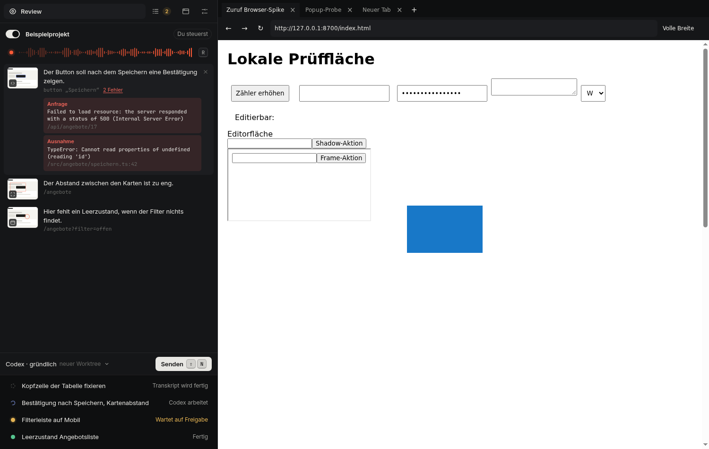
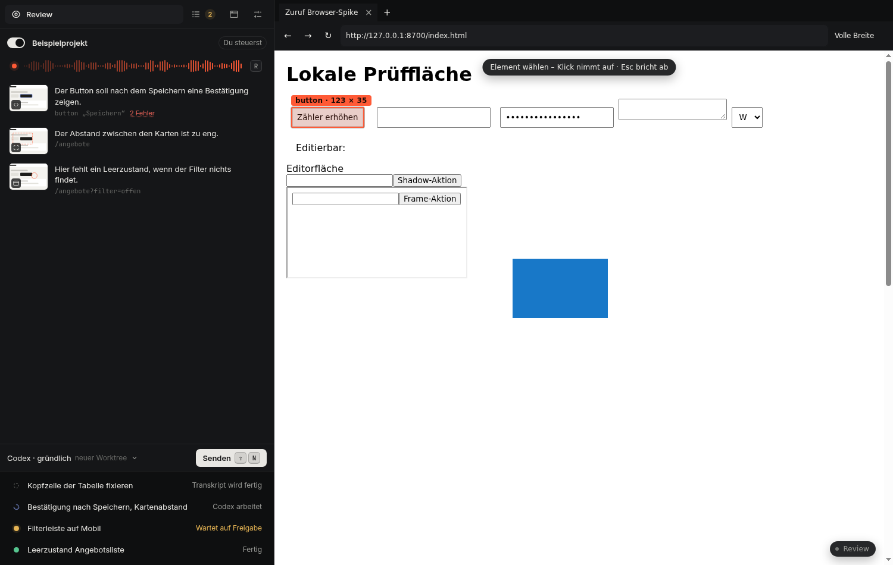
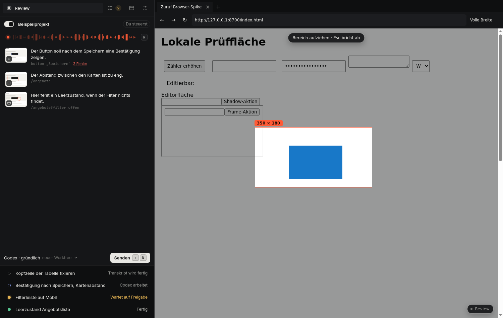
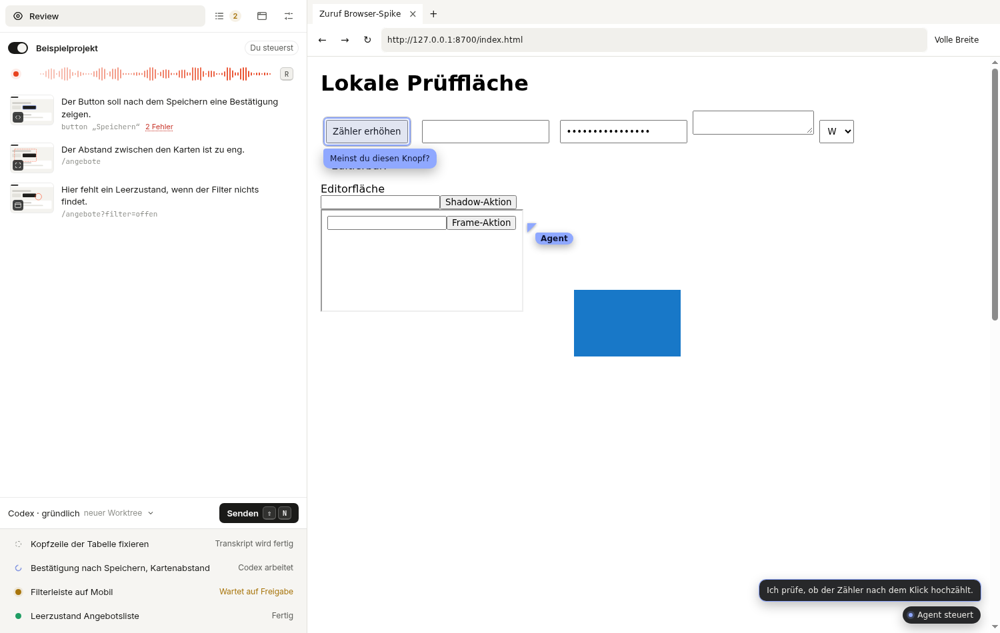

# Zuruf

Zuruf ist ein lokales Review-Werkzeug für Webanwendungen: ein eigenes Browserfenster, in dem die App neben der geprüften Seite sitzt. Man markiert per Tastendruck, was nicht stimmt, spricht oder tippt dazu und schickt alles gesammelt als Aufgabe an einen Coding-Agenten in [T3 Code](https://app.t3.codes).



*Die Bilder zeigen die Beispieldaten der Oberfläche.*

## Was es kann

- **Ein Fenster.** Chromium ist eingebaut. Es gibt keine Browser-Extension und kein zweites Programm, zwischen dem man wechselt.
- **Aufnehmen per Taste.** `W` nimmt die ganze Ansicht sofort auf. `D` lässt ein Element wählen, `S` einen Bereich aufziehen.
- **Diktieren.** Was man nach einer Aufnahme sagt, gehört zu dieser Aufnahme (über Voxtype).
- **Fehler der Seite reisen mit.** Konsolenfehler, unbehandelte Ausnahmen und fehlgeschlagene Anfragen hängen automatisch an jeder Aufnahme und gehen mit an den Agenten.
- **Seitenbreiten.** Ein Knopf zeigt die Seite in voller Breite, 1024, 768 oder 390 Pixel – mit echtem Viewport.
- **Zusammenarbeit mit Agenten.** Ein Agent kann den Browser steuern; man sieht seinen Zeiger, seine Fortschrittsmeldungen und was er einem zeigen will. Übernehmen geht jederzeit und gewinnt sofort.

| Element wählen (`D`) | Bereich aufziehen (`S`) | Agent bei der Arbeit |
|---|---|---|
|  |  |  |

## Voraussetzungen

Zuruf ist für **Linux** gebaut und auf Arch mit Hyprland (Wayland) ausgerichtet; X11 funktioniert ebenfalls. Windows und macOS werden nicht unterstützt.

Zum Betrieb:

- [T3 Code](https://app.t3.codes), lokal laufend – dorthin gehen die Aufgaben
- Voxtype und PipeWire – nur für das Diktat; ohne sie bleibt Tippen
- Hyprland – nur für die desktopweiten Kurzbefehle

Zum Bauen:

- Rust stable (empfohlen über [mise](https://mise.jdx.dev))
- Node 26 und pnpm 11
- `cmake`, `ninja` und `python3` (das Installationsskript benutzt es)
- rund 2 GB freier Plattenplatz und 4 GB Arbeitsspeicher für den Build

Auf Arch:

```sh
sudo pacman -S --needed base-devel cmake ninja python nodejs pnpm mise
mise use -g rust@stable
```

## Installieren

```sh
git clone https://github.com/LordOfMim/zuruf.git
cd zuruf
./install.sh
```

`install.sh` baut Oberfläche, Seiten-Agent und die Rust-Programme und installiert alles in den Benutzerbereich – ohne `sudo`:

| Was | Wohin |
|---|---|
| `zuruf` (Dienst und Kommandozeile) | `~/.local/bin/zuruf` |
| Browserfenster mit Chromium-Laufzeit, rund 330 MB | `~/.local/lib/zuruf/` |
| systemd-Benutzerdienst | `~/.config/systemd/user/zuruf.service` |
| Starter und Icon | `~/.local/share/applications/zuruf.desktop` |

Beim ersten Build lädt Cargo die Chromium-Laufzeit (CEF, rund 140 MB) nach `~/.cache/zuruf/cef`; das dauert einige Minuten. Die Installation startet und aktiviert nichts von selbst.

Danach:

```sh
zuruf doctor                                   # prüft, was da ist und was fehlt
systemctl --user daemon-reload
systemctl --user enable --now zuruf.service    # Dienst dauerhaft starten
zuruf open                                     # Fenster öffnen
```

`~/.local/bin` muss im `PATH` liegen. Wer den Dienst nicht dauerhaft einrichten will, lässt die beiden `systemctl`-Zeilen weg: `zuruf open` startet ihn bei Bedarf selbst.

## Erste Schritte

1. **T3 Code verbinden:** im Fenster unter „Einrichten“ auf „Verbinden“, oder `zuruf t3 pair --origin http://127.0.0.1:3773`. Die Freigabe bestätigt man in T3.
2. **Projekt anlegen:** das Verzeichnis des Repositorys und die Adresse, unter der die Anwendung lokal läuft (zum Beispiel `http://localhost:5173`).
3. **Agentenprofil wählen** – Anbieter und Modell aus dem Katalog von T3.
4. **Sitzung starten:** unter „Sitzungen“. Das Fenster zeigt jetzt links Zuruf und rechts die Seite.
5. **Review einschalten** und loslegen.

## Bedienung

Im Review-Modus, solange der Fokus nicht in einem Textfeld steht:

| Taste | Wirkung |
|---|---|
| `W` | ganze Ansicht sofort aufnehmen |
| `D` | Element wählen: es leuchtet unter dem Zeiger auf, Klick oder Enter nimmt es auf |
| `S` | Bereich aufziehen, Loslassen nimmt auf |
| `E` | Kommentar tippen |
| `R` | Diktat ein und aus |
| `Umschalt+N` | gesammelte Einträge als Aufgabe senden |
| `Esc` | Auswahl abbrechen |

In Textfeldern bleiben die Tasten normale Eingaben; mit `Alt` dazu (etwa `Alt+W`) wirken sie auch dort. Alle Tasten lassen sich in den Einstellungen ändern.

Das Fenster selbst kennt die üblichen Browser-Kurzbefehle: `Strg+T`, `Strg+W`, `Strg+L`, `Strg+R`, `Alt+←/→`, `Strg+Plus/Minus`, `F12` für die Entwicklerwerkzeuge.

Alles Weitere steht im [Benutzerhandbuch](docs/benutzerhandbuch.md).

## Aktualisieren und Entfernen

```sh
git pull && ./install.sh        # aktualisieren
./uninstall.sh                  # entfernen, Daten bleiben
./uninstall.sh --purge          # entfernen samt Daten, nach Rückfrage
```

Die Daten liegen unter `~/.local/share/zuruf`, `~/.local/state/zuruf` und `~/.config/zuruf`.

## Wenn etwas nicht geht

- **`zuruf doctor`** zeigt, welche Voraussetzung fehlt.
- **Der Build findet `cmake` oder `ninja` nicht:** beide installieren (siehe oben).
- **Der Download der Chromium-Laufzeit scheitert** (etwa hinter einem Proxy, der TLS aufbricht): `node tools/dev/fetch-cef.mjs 156.0.26 ~/.cache/zuruf/cef` lädt sie mit den Zertifikaten des Systems.
- **Das Fenster erscheint nicht:** Chromiums Protokoll des letzten Starts steht in `~/.local/share/zuruf/sessions/<Sitzung>/shell.log` beziehungsweise `~/.local/share/zuruf/app-window/shell.log`.
- **Hyprland-Regeln:** Alle Zuruf-Fenster tragen die App-ID `zuruf`.

## Entwickeln

```sh
pnpm install
pnpm --filter @zuruf/ui build && pnpm --filter @zuruf/page build
cargo build
cargo test --workspace
bash tests/e2e/run.sh          # alle Abnahmeläufe, braucht einen Bildschirm
```

Ohne Linux-Desktop – auf einem fremden Rechner oder in CI – lässt sich alles im Container bauen und unter einem virtuellen Bildschirm testen: [tools/dev/README.md](tools/dev/README.md).

Aufbau und Entscheidungen: [docs/architecture.md](docs/architecture.md). Regeln für Mitwirkende und Agenten: [AGENTS.md](AGENTS.md).

## Stand

Gebaut und geprüft wurde der aktuelle Stand in einem Linux-Container unter X11 und Wayland. Auf einem echten Hyprland-Rechner stehen noch aus: Fensterfokus und globale Kurzbefehle, GPU-Darstellung, Chromiums Sandbox, das Diktat mit Voxtype und die Anbindung an T3. Einzelheiten in [docs/abnahme.md](docs/abnahme.md).

Das Fenster ist ein Review-Browser, kein Alltagsbrowser: Downloads, Berechtigungsabfragen und eine Passwortverwaltung gibt es nicht.

## Lizenz

MIT.
